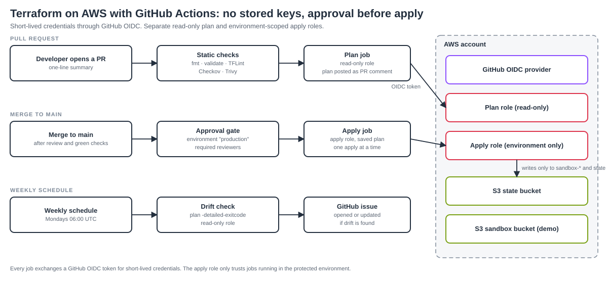

# github-actions-aws-pipeline

[](https://github.com/MusaveerHolalkere25/github-actions-aws-pipeline/actions/workflows/ci.yml)
[](LICENSE)

A reference CI/CD pipeline for **Terraform on AWS using GitHub Actions**: no stored AWS keys (GitHub OIDC), a read-only plan on every pull request, an approval gate before apply, separate roles for plan and apply, security scanning, and weekly drift detection.

> An independent reference project built from scratch for learning and demonstration. The sandbox stack deploys a single S3 bucket so you can see the whole flow cheaply.



## What it does

1. **Pull request:** formatting, `validate`, TFLint, Checkov and a Trivy config scan run first. Then a **read-only** role runs `terraform plan` and posts it as a PR comment.
2. **Merge to main:** the deploy workflow stops at an **approval gate** (GitHub environment `production` with required reviewers). After approval, a **separate apply role** applies a saved plan.
3. **Weekly drift check:** `terraform plan -detailed-exitcode` runs on a schedule and opens (or updates) a GitHub issue if reality differs from the code.

## Security design

- **No long-lived keys.** Jobs exchange a GitHub OIDC token for short-lived AWS credentials.
- **Two roles, two trust policies.** The plan role (read-only) is assumable from pull requests and from `main`. The apply role is assumable **only** by jobs running in the protected `production` environment, so a pull request can never apply.
- **Least privilege for apply.** The apply role can write only to the state bucket and to `<project>-sandbox-*` buckets, on top of read-only access.
- **State bucket:** versioned, encrypted, private, TLS-only, with native S3 locking (`use_lockfile`).
- **Concurrency control:** only one apply can run at a time.
- **Dependency hygiene:** Dependabot keeps Actions and Terraform providers updated.

## Repository layout

```
bootstrap/                 one-time setup: state bucket, GitHub OIDC provider, plan and apply roles
stacks/sandbox/            the stack the pipeline deploys (a small S3 bucket)
.github/workflows/
  ci.yml                   checks + plan on pull requests
  deploy.yml               apply on main, behind the approval gate
  drift.yml                weekly drift detection
  terraform-reusable.yml   reusable workflow used by ci.yml and deploy.yml
```

## Setup

Use a **sandbox AWS account** and a **public repository** with this exact name, or change `github_repo` in the bootstrap variables.

**1. Bootstrap the AWS side (once, from your machine, with admin credentials):**

```bash
cd bootstrap
cp terraform.tfvars.example terraform.tfvars   # set github_owner to your GitHub username
terraform init
terraform apply
terraform output repository_variables
```

If the account already has a GitHub OIDC provider, set `create_oidc_provider = false`.

**2. Add repository variables** (Settings → Secrets and variables → Actions → **Variables**, not secrets): `AWS_REGION`, `TF_STATE_BUCKET`, `AWS_PLAN_ROLE_ARN` and `AWS_APPLY_ROLE_ARN`, using the output above. Until they are set, the AWS jobs are skipped and the checks still run.

**3. Create the `production` environment** (Settings → Environments), add yourself as a required reviewer, and limit it to the `main` branch.

**4. Try it.** Change something in `stacks/sandbox` (for example, add a tag) on a branch and open a pull request. You should see the checks pass and a plan comment appear. Merge, approve the deployment, and watch the apply.

Recommended: protect `main` with a branch rule that requires the `ci` checks to pass.

## Cost and clean-up

The demo costs close to nothing (two small S3 buckets). To remove it, empty and destroy the sandbox stack first, then the bootstrap. Both S3 buckets are versioned, so delete all object versions before destroying them. Delete the `production` environment and the repository variables afterwards.

## Design decisions

- **OIDC over access keys:** nothing to store, rotate or leak.
- **Plan and apply are different identities:** reviewing a plan should never grant write access.
- **Environment-scoped apply role:** the trust policy requires `environment:production`, so GitHub's approval rules are enforced by AWS too, not just by the workflow.
- **Plans run with `-lock=false`:** pull-request plans never take the state lock, so a PR can't block a real apply.
- **Apply uses a saved plan from the same run:** what was planned is what is applied.
- **One reusable workflow:** plan and apply share the same init and credential steps.

## Limitations and next steps

- One account and one stack. Multi-account (per-environment roles) and a matrix over several stacks are the natural next step.
- Actions are pinned by version tag. For stricter supply-chain control, pin them by commit SHA (Dependabot can maintain those).
- Pull requests from forks don't receive repository variables, so the AWS jobs are skipped for them by design.
- Roadmap: cost estimates on PRs (Infracost), policy checks (OPA/Conftest), and a manual destroy workflow.

## Author

Built by [Musaveer Holalkere](https://musaveerholalkere25.github.io), Cloud & DevOps Engineer. [LinkedIn](https://www.linkedin.com/in/musaveerah)

## License

[MIT](LICENSE)
